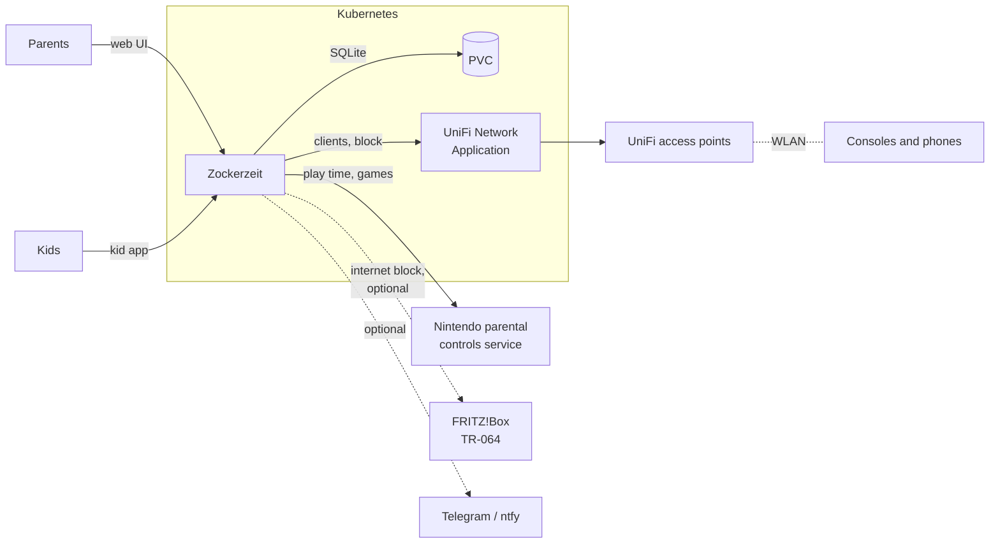

# zockerzeit

[](https://github.com/slauger/zockerzeit/actions/workflows/ci.yaml)
[](https://goreportcard.com/report/github.com/slauger/zockerzeit)
[](LICENSE)

Zockerzeit ("gaming time") is a self-hosted dashboard for parents that shows how long and what the kids play. Console play time comes from the Nintendo Switch parental controls, per kid and per game. Phones and consoles are seen in a UniFi WLAN, so you also know when and where they were online. Parents set time windows and daily or weekly budgets per kid, get notified when a kid starts playing, and can optionally cut the WLAN or the internet of a device outside its time windows.

<picture>
  <source media="(prefers-color-scheme: dark)" srcset="docs/images/dashboard-dark.png">
  
</picture>

- 🍄 **Nintendo play time** - connect one or more Nintendo accounts. Each console belongs to a kid and everything played on it counts for that kid, whichever user is signed in. Lend a console to a sibling with one tap ("Ist jetzt bei ...")
- 🕹️ **Games** - every game Nintendo reported with cover, play time per kid, last played and on which console
- 🎮 **Time windows and budgets** - daily and weekly limits per kid, separately for consoles (Nintendo time) and phones (minutes with traffic), plus time windows per weekday
- 📶 **Presence** - when and where (which access point) consoles and phones were online, as a timeline and heatmap
- 🔔 **Notifications** - Telegram or ntfy when a kid starts playing, when the time is almost up or when a device was blocked, each switchable
- ⛔ **Optional blocking** - per device a switch to block it outside its time windows, plus lock buttons. Either disconnect it from the WLAN (UniFi) or cut only its internet (FRITZ!Box). Used up budgets never block, a blocked console could no longer report its play time
- 📱 **Kid app** - an installable app (PWA) per kid that shows the remaining time
- 🏠 **Self-hosted** - a single Go binary with SQLite. Names, rules and covers stay in your database, pages load nothing from other hosts

The web interface is in German.

| Games | History |
|---|---|
| <picture><source media="(prefers-color-scheme: dark)" srcset="docs/images/games-dark.png"></picture> | <picture><source media="(prefers-color-scheme: dark)" srcset="docs/images/history-dark.png"></picture> |
| **Rules** | **Devices** |
| <picture><source media="(prefers-color-scheme: dark)" srcset="docs/images/rules-dark.png"></picture> | <picture><source media="(prefers-color-scheme: dark)" srcset="docs/images/device-dark.png"></picture> |


## How it works



- **Nintendo** - every ten minutes Zockerzeit fetches consoles, users, daily play time per game and the game list from the Nintendo Switch Parental Controls service. Play time that arrived since the last fetch is attributed to the kid the console belongs to, or to the kid it is lent to right now. Covers and avatars are copied into the database once.
- **WLAN** - every minute Zockerzeit asks the UniFi controller which clients are connected and how much traffic they produced, and matches them to the managed devices by MAC address. For consoles this is presence only (a console in standby stays in the WLAN, games also run offline). For phones the minutes with traffic count against the phone budget.
- **Rules** - after each poll the budgets and time windows are evaluated for the dashboard, the kid app and the notifications. Only devices with "Außerhalb der Zeitfenster sperren" switched on are blocked, via UniFi (`block-sta`) or the FRITZ!Box (`X_AVM-DE_HostFilter`). Devices that are not assigned to a kid are never touched.

All configuration (kids, rules, devices, Nintendo accounts, notification channels) lives in the SQLite database and is edited in the web UI. The config file only holds connection settings.

## Quick Start

Try the UI with a simulated controller and sample data:

```bash
make demo
# open http://localhost:8080
```

Run against a real controller:

```bash
cp config.example.yaml config.yaml   # set unifi.url
export ZOCKERZEIT_UNIFI_USERNAME=zockerzeit
export ZOCKERZEIT_UNIFI_PASSWORD=...
export ZOCKERZEIT_ADMIN_PASSWORD=...
export ZOCKERZEIT_SESSION_SECRET="$(openssl rand -hex 32)"
make run
```

## Deployment on Kubernetes

The container image is published to `ghcr.io/slauger/zockerzeit`, the Helm chart lives in [charts/zockerzeit](charts/zockerzeit) and is published to `oci://ghcr.io/slauger/charts/zockerzeit`.

```bash
kubectl create namespace zockerzeit
kubectl -n zockerzeit create secret generic zockerzeit \
  --from-literal=ZOCKERZEIT_UNIFI_USERNAME=zockerzeit \
  --from-literal=ZOCKERZEIT_UNIFI_PASSWORD='...' \
  --from-literal=ZOCKERZEIT_ADMIN_PASSWORD='...' \
  --from-literal=ZOCKERZEIT_SESSION_SECRET="$(openssl rand -hex 32)"

helm install zockerzeit oci://ghcr.io/slauger/charts/zockerzeit -n zockerzeit \
  --set config.unifi.url=https://unifi.unifi.svc.cluster.local:8443 \
  --set secret.existingSecret=zockerzeit
```

See the [chart README](charts/zockerzeit/README.md) for all values. Run a single replica only, the database is SQLite. Keep the session secret stable: it encrypts the Nintendo tokens and notification channels.

## Setup

1. In the UniFi controller create a dedicated local admin account for Zockerzeit (Network permissions only).
2. **Regeln**: create a profile per kid with time windows (`15:00-18:30`) and limits in minutes, separately for consoles and phones.
3. **Geräte**: assign the consoles and phones from the WLAN to a kid. The kid a console is assigned to is the one its Nintendo play time counts for.
4. In the Nintendo Switch Parental Controls app link every console to one Nintendo account (one account can manage several consoles).
5. **Einstellungen → Nintendo**: connect the account(s) and map each Nintendo console to its device in Zockerzeit.
6. **Einstellungen → Benachrichtigungen**: add a Telegram bot or an ntfy topic and choose the events.
7. Optional: switch on "Außerhalb der Zeitfenster sperren" for devices that should be blocked at night, and turn off the test mode.

On iPhones set *Private WLAN-Adresse* to *fest* (fixed) for your WLAN, otherwise the MAC address rotates and the device shows up as a new one.

## Limitations

- The Nintendo integration uses the undocumented API of the Nintendo Switch Parental Controls app, as implemented by the community library [pynintendoparental](https://github.com/pantherale0/pynintendoparental). It can break when Nintendo changes it.
- Nintendo reports minutes per day, user and game, not when exactly. Zockerzeit attributes new minutes at the time they arrive. Consoles only upload while online, so time played offline arrives later and counts for the console's owner.
- Users on a Switch cannot be protected by a PIN, therefore play time counts per console and not per Nintendo user.
- Blocking only works for devices behind UniFi access points (WLAN block) or in the FRITZ!Box home network (internet block). The FRITZ!Box cannot block single devices in its guest network. Blocking does not stop mobile data on phones.
- Devices are identified by MAC address. A device with a new (random) MAC shows up as a new, unmanaged device.
- Blocks are stored in the controller or the FRITZ!Box. If Zockerzeit is down, blocked devices stay blocked until it is back.

## Configuration

All options are documented in [config.example.yaml](config.example.yaml). Secrets are read from environment variables:

| Variable | Purpose |
|----------|---------|
| `ZOCKERZEIT_UNIFI_USERNAME` / `ZOCKERZEIT_UNIFI_PASSWORD` | UniFi local account |
| `ZOCKERZEIT_UNIFI_API_KEY` | Alternative to username/password (UniFi OS) |
| `ZOCKERZEIT_ADMIN_PASSWORD` | Password for the parent UI |
| `ZOCKERZEIT_SESSION_SECRET` | Signs session cookies and encrypts Nintendo tokens and notification channels. Required for Nintendo and own notification channels |
| `ZOCKERZEIT_FRITZBOX_USERNAME` / `ZOCKERZEIT_FRITZBOX_PASSWORD` | FRITZ!Box user with the right "FRITZ!Box Einstellungen", enables internet-only blocking (optional) |
| `ZOCKERZEIT_NTFY_TOKEN` | Access token for the ntfy topic from the config file (optional) |
| `ZOCKERZEIT_DRY_RUN` | Initial value of the test mode |

## Local Development

```bash
make demo      # UI with simulated controller and sample data
make test      # unit tests with race detector
make cover     # tests with 80% coverage gate
make lint      # golangci-lint
make ci        # everything CI runs
```

## License

Apache License 2.0
