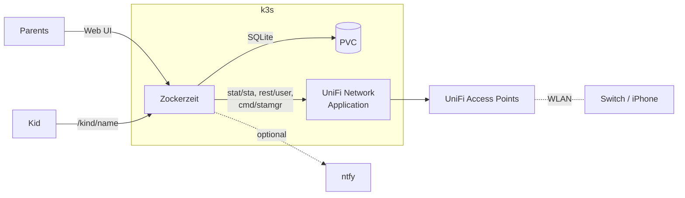

# zockerzeit

[](https://github.com/slauger/zockerzeit/actions/workflows/ci.yaml)
[](https://goreportcard.com/report/github.com/slauger/zockerzeit)
[](LICENSE)

Zockerzeit tracks and limits the play time of kids by blocking their consoles and phones on a UniFi WLAN. Parents agree on time windows and daily or weekly budgets, Zockerzeit records when, how long and where each device is used and cuts the WLAN when the time is up, without anyone having to walk over and argue.

- 🎮 **Time windows and budgets** - per weekday windows, daily and weekly limits per kid, separately for consoles and phones (night lock included)
- 📊 **History** - play time per day and device, timeline per day, weekday/hour heatmap, usage per room (access point)
- ⛔ **Automatic blocking** - devices are blocked and unblocked via the UniFi controller
- 👆 **Parent controls** - one tap for bonus minutes, free play, lock for an hour or until tomorrow
- 👫 **Shared consoles** - release a shared device for a sibling, time counts on the sibling's budget
- 🧒 **Kid view** - a read-only page that shows the remaining time, so nobody has to ask
- 🔔 **Push warnings** - optional ntfy notifications 10 and 5 minutes before the end
- 🧪 **Test mode** - records and shows decisions without blocking anything (default)

## Architecture



Every minute Zockerzeit asks the controller which clients are connected and how much traffic they produced. Consoles count as playing while connected (they drop off the WLAN in standby), phones only while they produce traffic. The minutes are stored per device and attributed to a profile, parallel use of several devices counts once. After each poll the rules are evaluated and devices are blocked or unblocked with `block-sta` / `unblock-sta`. Devices that are not assigned to a profile are never touched.

## Quick Start

Try the UI with a simulated controller and three weeks of sample data:

```bash
make demo
# open http://localhost:8080
```

Run against a real controller:

```bash
cp config.example.yaml config.yaml   # set unifi.url
export ZOCKERZEIT_UNIFI_USERNAME=zockerzeit
export ZOCKERZEIT_UNIFI_PASSWORD=...
export ZOCKERZEIT_ADMIN_PASSWORD=...
make run
```

## Deployment on Kubernetes

```bash
kubectl create namespace zockerzeit
kubectl -n zockerzeit create secret generic zockerzeit \
  --from-literal=ZOCKERZEIT_UNIFI_USERNAME=zockerzeit \
  --from-literal=ZOCKERZEIT_UNIFI_PASSWORD='...' \
  --from-literal=ZOCKERZEIT_ADMIN_PASSWORD='...' \
  --from-literal=ZOCKERZEIT_SESSION_SECRET="$(openssl rand -hex 32)"

helm install zockerzeit charts/zockerzeit -n zockerzeit \
  --set config.unifi.url=https://unifi.unifi.svc.cluster.local:8443 \
  --set secret.existingSecret=zockerzeit \
  --set image.tag=main
```

See the [chart README](charts/zockerzeit/README.md) for all values.

## Setup

1. In the UniFi controller create a dedicated local admin account for Zockerzeit (Network permissions only). Do not reuse your own account.
2. Open **Regeln** and create a profile per kid with time windows (`15:00-18:30`) and limits in minutes.
3. Open **Geräte** and assign the consoles and phones currently in the WLAN. Consoles use *wenn verbunden*, phones *bei Datenverkehr*. Mark consoles used by siblings as *gemeinsam genutzt*.
4. On iPhones set *Private WLAN-Adresse* to *fest* for the kids network, otherwise the MAC address can change and bypass the block.
5. Let it run in test mode for a few days and compare the **Verlauf** with reality, then set `dryRun: false`.

## Limitations

- Only WLAN clients behind UniFi access points can be blocked. Devices connected to another WLAN (e.g. the router's own) or via cable to a non-UniFi switch are out of reach.
- Blocking the WLAN does not stop mobile data on phones. Use Screen Time / Family Link for that.
- Consoles in standby with downloads enabled may stay connected and count as playing. If the history shows play time at night, disable automatic downloads in sleep mode on the console or switch the device to traffic mode.
- Zockerzeit sees connection times and traffic volume, not which game or app is used.

## Configuration

All options are documented in [config.example.yaml](config.example.yaml). Secrets are read from environment variables:

| Variable | Purpose |
|----------|---------|
| `ZOCKERZEIT_UNIFI_USERNAME` / `ZOCKERZEIT_UNIFI_PASSWORD` | UniFi local account |
| `ZOCKERZEIT_UNIFI_API_KEY` | Alternative to username/password (UniFi OS) |
| `ZOCKERZEIT_ADMIN_PASSWORD` | Password for the parent UI |
| `ZOCKERZEIT_SESSION_SECRET` | Signs session cookies, keeps logins across restarts |
| `ZOCKERZEIT_NTFY_TOKEN` | Access token for ntfy (optional) |
| `ZOCKERZEIT_DRY_RUN` | Overrides `dryRun` |

## Local Development

```bash
make test      # unit tests with race detector
make cover     # tests with 80% coverage gate
make lint      # golangci-lint
make ci        # everything CI runs
```

## License

Apache License 2.0
