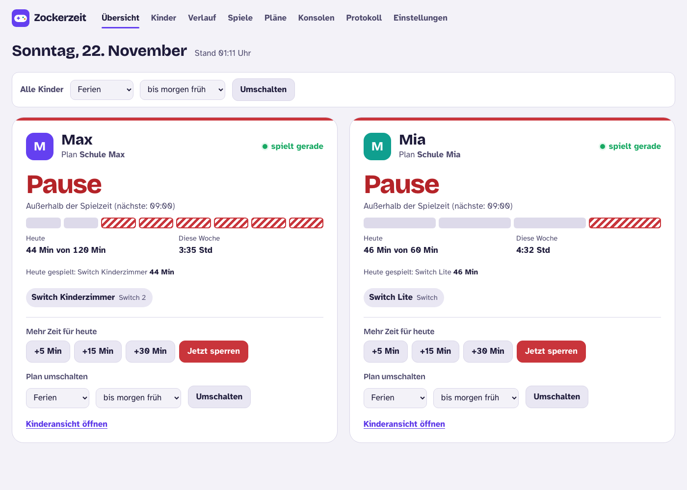
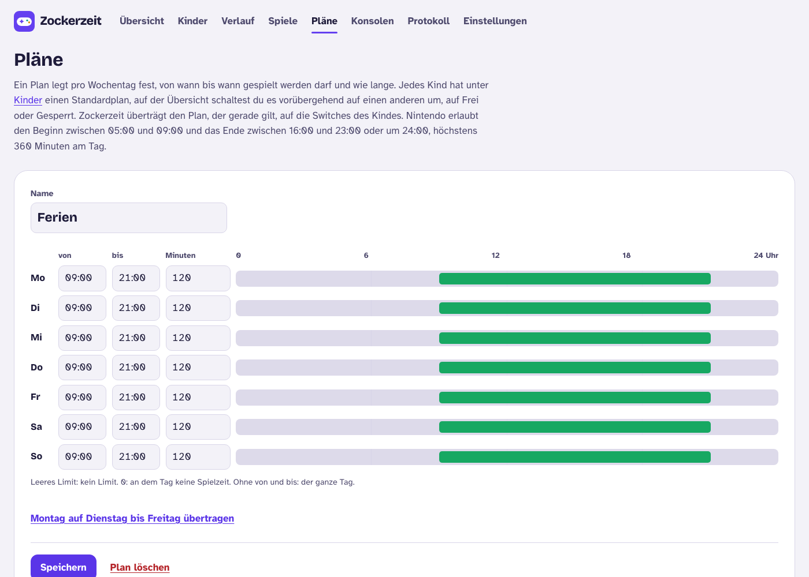
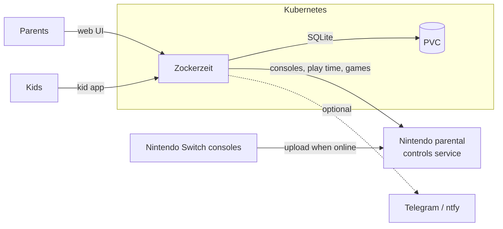

# zockerzeit

[](https://github.com/slauger/zockerzeit/actions/workflows/ci.yaml)
[](https://goreportcard.com/report/github.com/slauger/zockerzeit)
[](LICENSE)

Zockerzeit ("gaming time") is a self-hosted dashboard for parents that shows how long and what the kids play on their Nintendo Switch, and sets the rules on the consoles. Each kid follows a plan (time window and limit per weekday), which Zockerzeit writes to the kid's consoles through the Nintendo Switch parental controls. Switch a kid to another plan for a while, give it free time for the holidays or lock it right now with one tap. Zockerzeit reads back the play time per console and game and notifies the parents when a kid starts playing, when the time is almost up or when a kid keeps playing after it.

<picture>
  <source media="(prefers-color-scheme: dark)" srcset="docs/images/dashboard-dark.png">
  
</picture>

- 🍄 **Nintendo play time** - connect one or more Nintendo accounts of the parental controls app. Every console belongs to a kid and everything played on it counts for that kid, whichever user is signed in
- 📅 **Plans** - named plans with a time window and a limit per weekday ("Schule", "Ferien", ...). Every kid has a standard plan; switch a kid or all kids to another plan, to *Frei* or to *Gesperrt* until tomorrow morning, including a date or for good
- 🎮 **On the console** - the plan in force is written to the kid's consoles, and back to the standard plan when a switch ends. "Jetzt sperren" sets the play time to none and suspends a running game, "+15 Min" grants extra play time on the console
- 🕹️ **Games** - every game Nintendo reported with cover, play time per kid, last played and on which console
- 📈 **History** - play time per day and console, when during the week the kids play
- 🔔 **Notifications** - one Telegram bot for the family: every parent connects with one tap and chooses what to get (a kid starts playing, the time is almost up, a kid keeps playing after it). Optionally all messages to an ntfy topic
- 📱 **Apps** - the parent UI and a kid app per kid install as web apps (PWA). The kid app shows the remaining time and the kid's own statistics for today, 7 or 30 days or all time
- 🏠 **Self-hosted** - a single Go binary with SQLite. Names, rules and covers stay in your database, pages load nothing from other hosts

The web interface is in German.

| Games | History |
|---|---|
| <picture><source media="(prefers-color-scheme: dark)" srcset="docs/images/games-dark.png"></picture> | <picture><source media="(prefers-color-scheme: dark)" srcset="docs/images/history-dark.png"></picture> |
| **Plans** | **Consoles** |
| <picture><source media="(prefers-color-scheme: dark)" srcset="docs/images/plans-dark.png"></picture> | <picture><source media="(prefers-color-scheme: dark)" srcset="docs/images/consoles-dark.png"></picture> |


## How it works



- **Nintendo** - every ten minutes Zockerzeit fetches consoles, users, daily play time per game and the game list from the Nintendo Switch Parental Controls service. Play time that arrived since the last fetch is attributed to the kid the console belongs to. Covers and avatars are copied into the database once.
- **Plans on the console** - the plan in force for a kid (its standard plan or a switch) is written to its consoles as the parental controls rule per weekday: start, end, daily limit, and "suspend software" when the time is up. When a switch starts or ends, Zockerzeit writes within a minute; every ten minutes it checks the consoles and writes the plan again if someone changed it in the parental controls app. A console picks up new rules when it is online. Zockerzeit is the source of truth for the play time rules; age ratings and allowed games stay in the parental controls app.
- **Rules** - every minute the plans are evaluated against the Nintendo play time for the dashboard, the kid app and the notifications.

All configuration (kids, rules, consoles, Nintendo accounts, Telegram bot and recipients) lives in the SQLite database and is edited in the web UI. The config file only holds the time zone, the warning thresholds and an optional ntfy topic.

## Quick Start

Try the UI with sample data:

```bash
make demo
# open http://localhost:8080
```

Run it for real:

```bash
export ZOCKERZEIT_ADMIN_PASSWORD=...
export ZOCKERZEIT_SESSION_SECRET="$(openssl rand -hex 32)"
make run
```

## Deployment on Kubernetes

The container image is published to `ghcr.io/slauger/zockerzeit`, the Helm chart lives in [charts/zockerzeit](charts/zockerzeit) and is published to `oci://ghcr.io/slauger/charts/zockerzeit`.

```bash
kubectl create namespace zockerzeit
kubectl -n zockerzeit create secret generic zockerzeit \
  --from-literal=ZOCKERZEIT_ADMIN_PASSWORD='...' \
  --from-literal=ZOCKERZEIT_SESSION_SECRET="$(openssl rand -hex 32)"

helm install zockerzeit oci://ghcr.io/slauger/charts/zockerzeit -n zockerzeit \
  --set secret.existingSecret=zockerzeit
```

See the [chart README](charts/zockerzeit/README.md) for all values. Run a single replica only, the database is SQLite. Keep the session secret stable: it encrypts the Nintendo tokens and the Telegram bot token.

## Setup

1. In the Nintendo Switch Parental Controls app link every console to one Nintendo account (one account can manage several consoles).
2. **Pläne**: create a plan per set of rules, with start, end and limit per weekday. Nintendo allows a start between 05:00 and 09:00, an end between 16:00 and 23:00 or at 24:00 and at most 360 minutes a day.
3. **Kinder**: create the kids with their standard plan.
4. **Einstellungen → Nintendo**: connect the account(s). The consoles show up after the first fetch.
5. **Konsolen**: choose the kid each console belongs to. From now on Zockerzeit writes the kid's plan to the console.
6. **Einstellungen → Benachrichtigungen**: set up the Telegram bot once (create it with `@BotFather`, paste the token). Then every parent enters a name, ticks the messages they want and taps *Mit Telegram verbinden*: Telegram opens the bot, *Start* connects the chat.
7. **Einstellungen → Zugang ohne Passwort**: create a link for each phone and tablet and install the apps (see below).

### Installing the apps

Both the parent UI and the kid app are installable web apps (PWA) with their own icon and without the browser bar. On phones the parent UI has a tab bar at the bottom.

- **iPhone and iPad**: open the page in Safari, tap *Teilen* (share) and choose *Zum Home-Bildschirm*.
- **Android**: open the page in Chrome and choose *App installieren* in the menu, or tap *Installieren* in the hint Zockerzeit shows.
- **Without a password**: under *Einstellungen → Zugang ohne Passwort* create a secret link per device. A parent link signs the device in, a kid link opens only that kid's app. Open the link on the device and install it there; the installed app starts with its link and signs itself in. Lost a device? Revoke its link.
- The kid app shows only the kid's own time, statistics and games.

## Limitations

- The Nintendo integration uses the undocumented API of the Nintendo Switch Parental Controls app, as implemented by the community library [pynintendoparental](https://github.com/pantherale0/pynintendoparental). It can break when Nintendo changes it.
- Nintendo reports minutes per day, user and game, not when exactly. Zockerzeit attributes new minutes at the time they arrive. Consoles only upload while online, so time played offline arrives later and counts for the console's owner.
- Users on a Switch cannot be protected by a PIN, therefore play time counts per console and not per Nintendo user.
- Nintendo stores one rule per weekday and console: one time window and one limit per console. A kid with two consoles can play the limit on each of them; Zockerzeit adds both up and notifies when the kid plays on after its time.
- While extra play time from the parental controls app runs, a new plan waits until the next day, except *Gesperrt*, which takes the extra time back.

## Configuration

All options are documented in [config.example.yaml](config.example.yaml). Secrets are read from environment variables:

| Variable | Purpose |
|----------|---------|
| `ZOCKERZEIT_ADMIN_PASSWORD` | Password for the parent UI |
| `ZOCKERZEIT_SESSION_SECRET` | Signs session cookies and encrypts the Nintendo tokens and the Telegram bot token. Required for Nintendo and Telegram |
| `ZOCKERZEIT_NTFY_TOKEN` | Access token for the ntfy topic from the config file (optional) |

## Local Development

```bash
make demo      # UI with sample data
make test      # unit tests with race detector
make cover     # tests with 80% coverage gate
make lint      # golangci-lint
make ci        # everything CI runs
```

## License

Apache License 2.0
