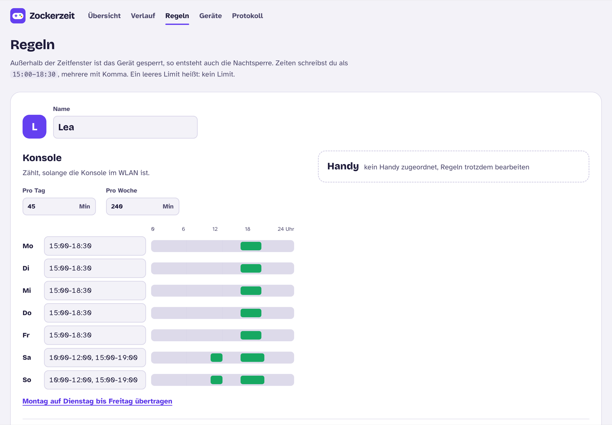
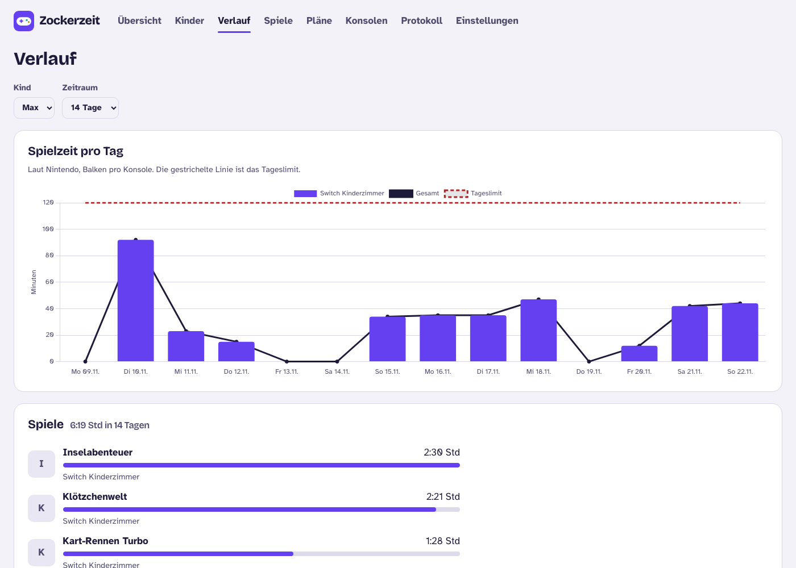
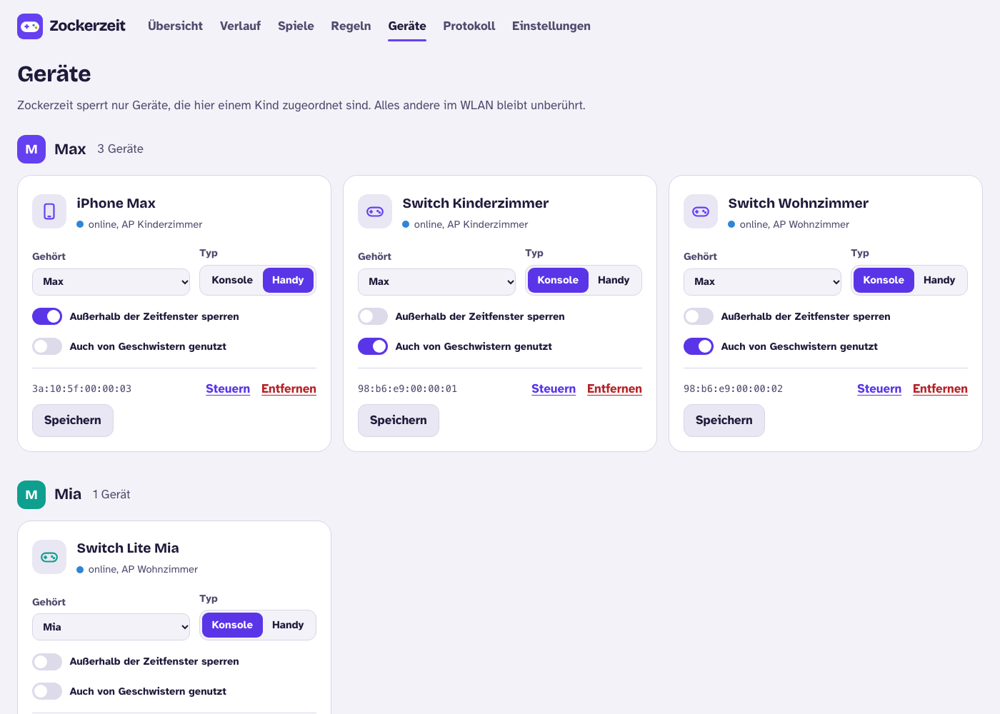
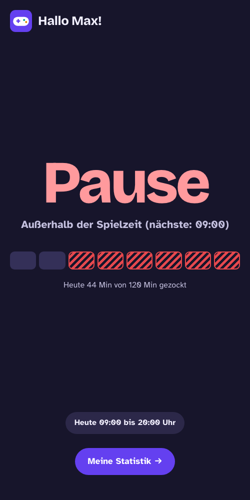
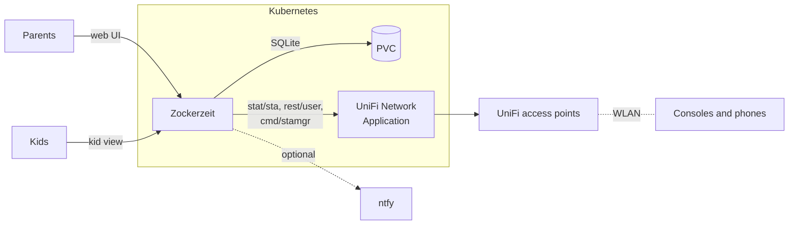

# zockerzeit

[](https://github.com/slauger/zockerzeit/actions/workflows/ci.yaml)
[](https://goreportcard.com/report/github.com/slauger/zockerzeit)
[](LICENSE)

Zockerzeit ("gaming time") tracks how long kids play and when they are online. Console play time comes from the Nintendo parental controls, per kid and per game; phones and consoles are seen in a UniFi WLAN, so you know when and where they were online. Parents agree on time windows and daily or weekly budgets, and can optionally cut the WLAN or the internet of a device outside its time windows or with one tap.

<picture>
  <source media="(prefers-color-scheme: dark)" srcset="docs/images/dashboard-dark.png">
  
</picture>

- 🎮 **Time windows and budgets** - weekday windows, daily and weekly limits per kid, separately for consoles and phones (the night lock is just a window)
- 🔋 **Energy bar** - remaining time at a glance, one segment per 15 minutes
- 📊 **History** - play time per day and device, a timeline per day, a weekday/hour heatmap and usage per room (access point)
- ⛔ **Optional blocking** - per device a switch to block it outside its time windows, plus lock buttons; either disconnect it from the WLAN (UniFi) or cut only its internet access (FRITZ!Box, TR-064). Used up budgets never block: a blocked console could not report its play time anymore
- 👆 **Parent controls** - one tap for bonus minutes, free play, a pause for an hour or until tomorrow
- 👫 **Shared consoles** - release a sibling's console for 30 minutes, the time counts on the right budget
- 🍄 **Nintendo parental controls** - connect one or more Nintendo accounts; console budgets count the play time Nintendo reports for the users mapped to a kid, with game names and covers in the history
- 📱 **Kid app** - an installable app (PWA) per kid that shows the remaining time, so nobody has to ask
- 🔔 **Push warnings** - optional ntfy notifications 10 and 5 minutes before the end
- 🧪 **Test mode** - records and shows decisions without blocking anything (default)
- 🏠 **Local only** - a single Go binary with SQLite, no cloud, no account, names and rules never leave your network

The web interface is in German.

| Rules per device type | History |
|---|---|
| <picture><source media="(prefers-color-scheme: dark)" srcset="docs/images/rules-dark.png"></picture> | <picture><source media="(prefers-color-scheme: dark)" srcset="docs/images/history-dark.png"></picture> |
| **Devices** | **Kid app** |
| <picture><source media="(prefers-color-scheme: dark)" srcset="docs/images/device-dark.png"></picture> |  |

## Architecture



Every minute Zockerzeit asks the controller which clients are connected and how much traffic they produced, and matches them to the managed devices by MAC address. This WLAN time is stored per device as activity: when and where a device was online. Phone budgets count the minutes with traffic. Console budgets count the play time from the Nintendo parental controls, fetched every ten minutes, because a console in standby stays in the WLAN and games also run offline. After each poll the rules are evaluated; devices with "block outside the time windows" switched on are blocked or unblocked with `block-sta` / `unblock-sta` or the FRITZ!Box. Devices that are not assigned to a kid are never touched.

All configuration (kids, rules, devices) lives in the SQLite database and is edited in the web UI. The config file only holds the connection settings.

## Quick Start

Try the UI with a simulated controller and three weeks of sample data:

```bash
make demo
# open http://localhost:8080
```

Run against a real controller:

```bash
cp config.example.yaml config.yaml   # set unifi.url
export ZOCKERZEIT_UNIFI_USERNAME=zockerzeit
export ZOCKERZEIT_UNIFI_PASSWORD=...
export ZOCKERZEIT_ADMIN_PASSWORD=...
make run
```

## Deployment on Kubernetes

The container image is published to `ghcr.io/slauger/zockerzeit`, the Helm chart lives in [charts/zockerzeit](charts/zockerzeit).

```bash
kubectl create namespace zockerzeit
kubectl -n zockerzeit create secret generic zockerzeit \
  --from-literal=ZOCKERZEIT_UNIFI_USERNAME=zockerzeit \
  --from-literal=ZOCKERZEIT_UNIFI_PASSWORD='...' \
  --from-literal=ZOCKERZEIT_ADMIN_PASSWORD='...' \
  --from-literal=ZOCKERZEIT_SESSION_SECRET="$(openssl rand -hex 32)"

helm install zockerzeit charts/zockerzeit -n zockerzeit \
  --set config.unifi.url=https://unifi.unifi.svc.cluster.local:8443 \
  --set secret.existingSecret=zockerzeit
```

See the [chart README](charts/zockerzeit/README.md) for all values. Run a single replica only, the database is SQLite.

## Setup

1. In the UniFi controller create a dedicated local admin account for Zockerzeit (Network permissions only). Do not reuse your own account.
2. Open **Regeln** and create a profile per kid with time windows (`15:00-18:30`) and limits in minutes, separately for consoles and phones.
3. Open **Geräte** and assign the consoles and phones currently in the WLAN. Mark consoles used by siblings as shared.
4. On iPhones set *Private WLAN-Adresse* to *fest* (fixed) for the kids' network, otherwise the MAC address rotates and the block no longer applies.
5. Let it run in test mode for a few days and compare the **Verlauf** with reality, then set `dryRun: false`.

## Limitations

- Only WLAN clients behind UniFi access points can be blocked. Devices on another WLAN (e.g. the router's own) or cabled to a non-UniFi switch are out of reach.
- Blocking does not stop mobile data on phones, calls always work. Use Screen Time or Family Link if you need more.
- Internet-only blocking via the FRITZ!Box works for devices in its home network only. The FRITZ!Box cannot block single devices in its guest network, and the device must have been online once so the FRITZ!Box knows it.
- Devices are identified by MAC address. A device with a new (random) MAC shows up as a new, unmanaged device.
- Consoles in standby with downloads enabled may stay connected and count as playing. If the history shows play time at night, disable downloads in sleep mode or switch the device to the phone type.
- Without the Nintendo integration Zockerzeit sees connection times and traffic volume, not which game or app is used.
- The Nintendo integration uses the undocumented API of the Nintendo Switch Parental Controls app, as implemented by the community library [pynintendoparental](https://github.com/pantherale0/pynintendoparental). It can break when Nintendo changes it. Consoles only report play time while they are online. Session tokens are stored encrypted with `ZOCKERZEIT_SESSION_SECRET`.
- Blocks are stored in the controller. If Zockerzeit is down, blocked devices stay blocked until it is back or you unblock them in UniFi.

## Configuration

All options are documented in [config.example.yaml](config.example.yaml). Secrets are read from environment variables:

| Variable | Purpose |
|----------|---------|
| `ZOCKERZEIT_UNIFI_USERNAME` / `ZOCKERZEIT_UNIFI_PASSWORD` | UniFi local account |
| `ZOCKERZEIT_UNIFI_API_KEY` | Alternative to username/password (UniFi OS) |
| `ZOCKERZEIT_ADMIN_PASSWORD` | Password for the parent UI |
| `ZOCKERZEIT_SESSION_SECRET` | Signs session cookies, keeps logins across restarts |
| `ZOCKERZEIT_NTFY_TOKEN` | Access token for ntfy (optional) |
| `ZOCKERZEIT_FRITZBOX_USERNAME` / `ZOCKERZEIT_FRITZBOX_PASSWORD` | FRITZ!Box user with the right "FRITZ!Box Einstellungen", enables internet-only blocking (optional) |
| `ZOCKERZEIT_DRY_RUN` | Overrides `dryRun` |

## Local Development

```bash
make demo      # UI with simulated controller and sample data
make test      # unit tests with race detector
make cover     # tests with 80% coverage gate
make lint      # golangci-lint
make ci        # everything CI runs
```

## License

Apache License 2.0
