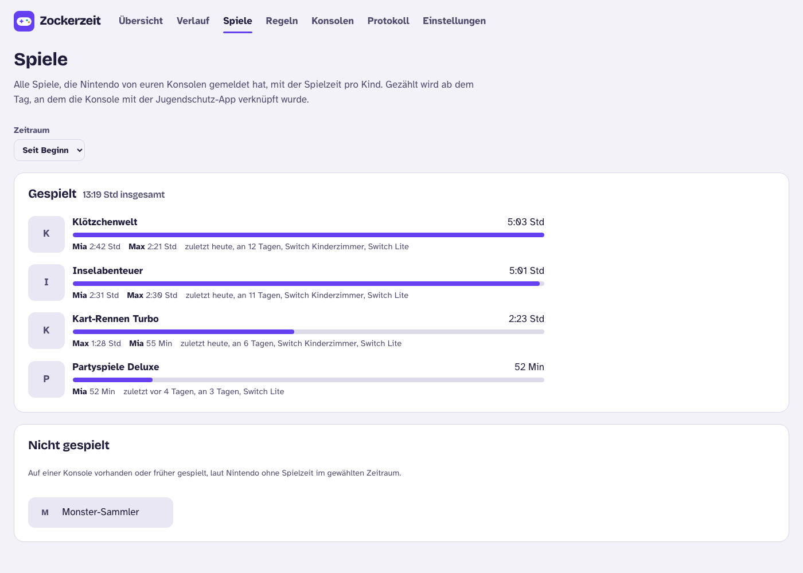
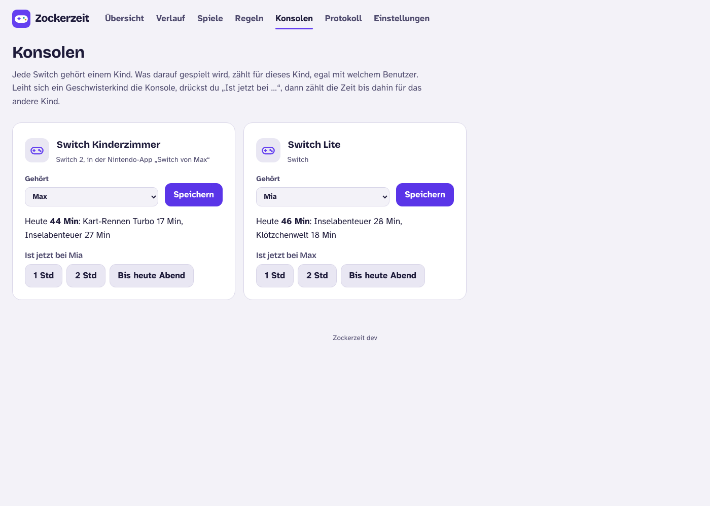
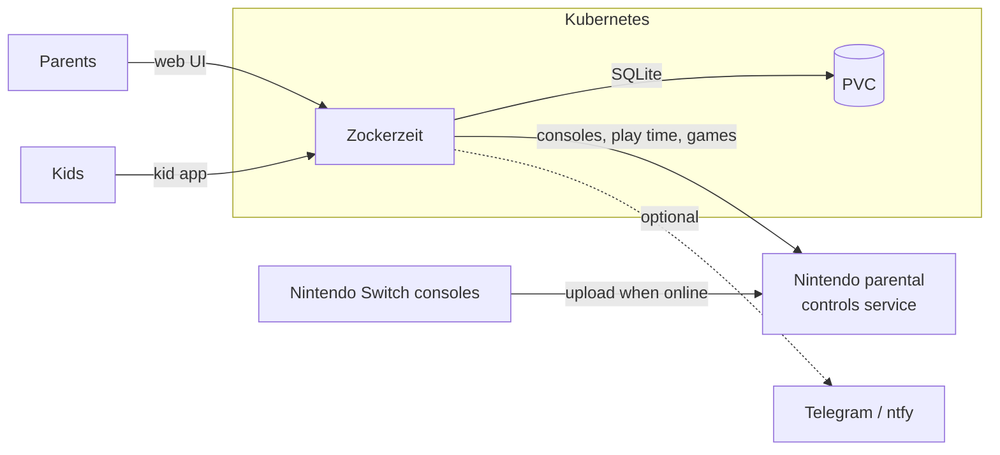

# zockerzeit

[](https://github.com/slauger/zockerzeit/actions/workflows/ci.yaml)
[](https://goreportcard.com/report/github.com/slauger/zockerzeit)
[](LICENSE)

Zockerzeit ("gaming time") is a self-hosted dashboard for parents that shows how long and what the kids play on their Nintendo Switch. It reads the play time per console, user and game from the Nintendo Switch parental controls, counts it per kid against time windows and daily or weekly limits, and notifies the parents when a kid starts playing, when the time is almost up or when a kid keeps playing after it.

<picture>
  <source media="(prefers-color-scheme: dark)" srcset="docs/images/dashboard-dark.png">
  
</picture>

- 🍄 **Nintendo play time** - connect one or more Nintendo accounts of the parental controls app. Every console belongs to a kid and everything played on it counts for that kid, whichever user is signed in
- 🔁 **Lending** - a sibling borrows a console: one tap ("Ist jetzt bei ...") and the time counts for the sibling until the evening
- 🎮 **Time windows and limits** - per kid, per weekday, daily and weekly, plus extra minutes for today
- 🕹️ **Games** - every game Nintendo reported with cover, play time per kid, last played and on which console
- 📈 **History** - play time per day and console, when during the week the kids play
- 🔔 **Notifications** - Telegram or ntfy when a kid starts playing, when the time is almost up or used up while playing, each switchable
- 📱 **Kid app** - an installable app (PWA) per kid with the remaining time and the own statistics for today, 7 or 30 days or all time
- 🏠 **Self-hosted** - a single Go binary with SQLite. Names, rules and covers stay in your database, pages load nothing from other hosts

The web interface is in German.

| Games | History |
|---|---|
| <picture><source media="(prefers-color-scheme: dark)" srcset="docs/images/games-dark.png"></picture> | <picture><source media="(prefers-color-scheme: dark)" srcset="docs/images/history-dark.png"></picture> |
| **Rules** | **Consoles** |
| <picture><source media="(prefers-color-scheme: dark)" srcset="docs/images/rules-dark.png"></picture> | <picture><source media="(prefers-color-scheme: dark)" srcset="docs/images/consoles-dark.png"></picture> |


## How it works



- **Nintendo** - every ten minutes Zockerzeit fetches consoles, users, daily play time per game and the game list from the Nintendo Switch Parental Controls service. Play time that arrived since the last fetch is attributed to the kid the console belongs to, or to the kid it is lent to right now. Covers and avatars are copied into the database once.
- **Rules** - every minute the time windows and limits of each kid are evaluated against the Nintendo play time for the dashboard, the kid app and the notifications.
- **Enforcement** - Zockerzeit does not block anything. What the console enforces (daily limit, bedtime, suspending the software) is set in the Nintendo parental controls app. Zockerzeit is the place to see the play time per kid across consoles and to get notified.

All configuration (kids, rules, consoles, Nintendo accounts, notification channels) lives in the SQLite database and is edited in the web UI. The config file only holds the time zone, the warning thresholds and an optional ntfy topic.

## Quick Start

Try the UI with sample data:

```bash
make demo
# open http://localhost:8080
```

Run it for real:

```bash
export ZOCKERZEIT_ADMIN_PASSWORD=...
export ZOCKERZEIT_SESSION_SECRET="$(openssl rand -hex 32)"
make run
```

## Deployment on Kubernetes

The container image is published to `ghcr.io/slauger/zockerzeit`, the Helm chart lives in [charts/zockerzeit](charts/zockerzeit) and is published to `oci://ghcr.io/slauger/charts/zockerzeit`.

```bash
kubectl create namespace zockerzeit
kubectl -n zockerzeit create secret generic zockerzeit \
  --from-literal=ZOCKERZEIT_ADMIN_PASSWORD='...' \
  --from-literal=ZOCKERZEIT_SESSION_SECRET="$(openssl rand -hex 32)"

helm install zockerzeit oci://ghcr.io/slauger/charts/zockerzeit -n zockerzeit \
  --set secret.existingSecret=zockerzeit
```

See the [chart README](charts/zockerzeit/README.md) for all values. Run a single replica only, the database is SQLite. Keep the session secret stable: it encrypts the Nintendo tokens and notification channels.

## Setup

1. In the Nintendo Switch Parental Controls app link every console to one Nintendo account (one account can manage several consoles).
2. **Regeln**: create a profile per kid with time windows (`15:00-18:30`) and daily or weekly limits.
3. **Einstellungen → Nintendo**: connect the account(s). The consoles show up after the first fetch.
4. **Konsolen**: choose the kid each console belongs to.
5. **Einstellungen → Benachrichtigungen**: add a Telegram bot or an ntfy topic and choose the events.
6. Open the kid app on the kid's phone or tablet (`/kind/<name>`) and add it to the home screen.

## Limitations

- The Nintendo integration uses the undocumented API of the Nintendo Switch Parental Controls app, as implemented by the community library [pynintendoparental](https://github.com/pantherale0/pynintendoparental). It can break when Nintendo changes it.
- Nintendo reports minutes per day, user and game, not when exactly. Zockerzeit attributes new minutes at the time they arrive. Consoles only upload while online, so time played offline arrives later and counts for the console's owner.
- Users on a Switch cannot be protected by a PIN, therefore play time counts per console and not per Nintendo user.
- Zockerzeit only shows and notifies. Limits on the console itself are set in the Nintendo parental controls app.

## Configuration

All options are documented in [config.example.yaml](config.example.yaml). Secrets are read from environment variables:

| Variable | Purpose |
|----------|---------|
| `ZOCKERZEIT_ADMIN_PASSWORD` | Password for the parent UI |
| `ZOCKERZEIT_SESSION_SECRET` | Signs session cookies and encrypts Nintendo tokens and notification channels. Required for Nintendo and own notification channels |
| `ZOCKERZEIT_NTFY_TOKEN` | Access token for the ntfy topic from the config file (optional) |

## Local Development

```bash
make demo      # UI with sample data
make test      # unit tests with race detector
make cover     # tests with 80% coverage gate
make lint      # golangci-lint
make ci        # everything CI runs
```

## License

Apache License 2.0
